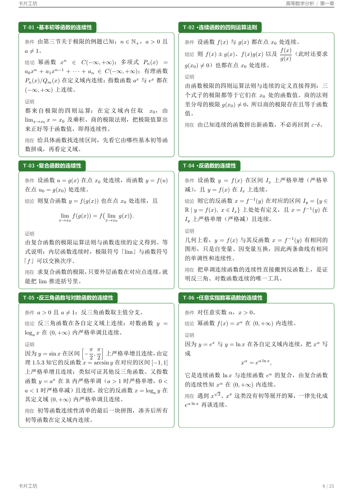
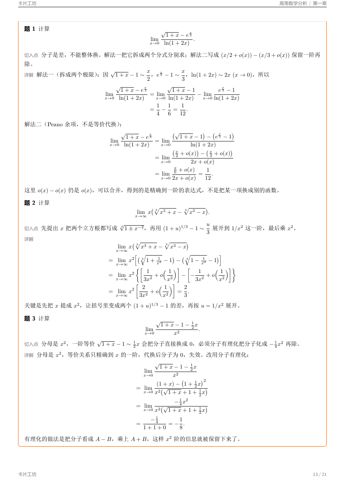

# 卡片工坊 · dsh-card-workshop

把教材、课件、试卷的 PDF 拆成**定义卡、定理卡、题型卡**，编成一份能翻的 A4 卡片 PDF。

考前翻课件，一页页滑过去，翻完什么也没记住。这个插件把一学期的 PDF 变成一套卡片：一页四张，定义、定理、题型各归各类，前面有索引带页码，PDF 书签也做好了。

| 定理卡 | 题型卡 |
|---|---|
|  |  |

左边是定理卡，一页六张：条件、结论分开写，证明照原文，原文没给证明的补上。右边是题型卡：认题特征、通法、易错点，然后是这一题型下的每一道题，都带切入点和完整详解。

## 出什么

- **定义卡**：术语、原文定义、记号、最容易读漏的那个词、一句用法
- **定理卡**：条件、结论、证明、用在哪儿
- **题型卡**：怎么认出这类题、通法、易错点，加每道题的完整题干、切入点、完整详解

同一题型的题自动并进一张卡，题一道不删，也不拿「代表题」凑数。卡片长了会跨页续，不裁内容。

## 用起来

1. 点左侧栏的「卡片工坊」
2. 选母文件夹（默认 `D:\卡片库`，可以换）
3. 选一到两级子文件夹。不存在时会停下来问「名字打错了，还是新建」，不会自己建
4. 选源 PDF，可以多份，内容合并成一份卡片集
5. 点「交给 AI」，剩下它自己做：逐页读、归类、写详解、排版、编译

成品落在你选的子文件夹里，文件名带批次时间戳。同一批次重编会覆盖同名文件，不堆版本。

## 装

让 AI 执行：

```
install_bundle github:AuRevoir22/dsh-card-workshop
```

或者到插件管理页，把同一个字符串填进来源。

**装完按 Ctrl+R 刷新页面**，左侧栏底部那排图标里才会多出「卡片工坊」。

### 环境要求

| 依赖 | 说明 |
|---|---|
| Windows | 只在 Windows 上测过 |
| DSH 桌面端 | 0.2.x |
| MiKTeX | 要 `xelatex` 和 `ctex` 宏包 |
| poppler | `pdftotext`、`pdftoppm`、`pdfinfo`，MiKTeX 自带 |

`xelatex --version` 能出东西，`pdftotext -v` 能出东西，就算齐了。

### 装不上怎么办

- 面板打开是白的、或者一级列表空着 —— 按 Ctrl+R 刷新一次
- 拆页正常，一出 PDF 就报「LaTeX 没编过」—— 没装 MiKTeX，或者 `xelatex` 不在 PATH 里
- `install_bundle` 拉不下来 —— `github:` 走 GitHub，国内时通时不通，重试几次；还不行就下载仓库压缩包，解压后把安装目标填成那个文件夹的路径

## 隐私

拆页那一步就把校名、姓名、班级、学号、电话、邮箱换成「某校 / 某某 / ××」。替换只记计数，不把原文留在任何中间文件里。排版编译完之后，整个中间目录自动删掉。

卡片上不写来源页码，也不生成核对表——想核对内容是否完整，翻前面的索引，卡号连号就是齐的。

## 花多少钱

按 DeepSeek 的价格算，一本 70 页左右的课件读下来大概一两块钱，页数越多越贵。

两种 PDF 差别很大：文字层正常的，正文抽取后会压掉一半空白，很便宜；PPT 导出的课件经常文字层是乱码（字体没带 ToUnicode），只能整本出图读，贵不少。

建议一次 20 页上下，分批做。出错重跑的成本也低。

## 已知限制

- 只在 Windows 上跑过，客户端拼路径用反斜杠
- 扫描件、乱码文字层只能看图，慢且贵
- 题型划分带主观性，一道题看着像两个题型很常见，按主导解法归一个，不重复收录也不丢

## License

MIT，见 [LICENSE](./LICENSE)。

---

## English

Splits a textbook or exam PDF into definition, theorem, and problem-type cards, renders them as one A4 card PDF, and files it under a subfolder of your card library.

A DSH desktop plugin: one sidebar entry, pick a PDF and a subfolder, and the agent reads it page by page, classifies the problems, and writes the solutions.

Install with `install_bundle github:AuRevoir22/dsh-card-workshop`, then refresh the page. Requires DSH desktop, MiKTeX with `xelatex` + `ctex`, and poppler (`pdftotext`, `pdftoppm`, `pdfinfo`) on `PATH`. Windows only. MIT licensed.
